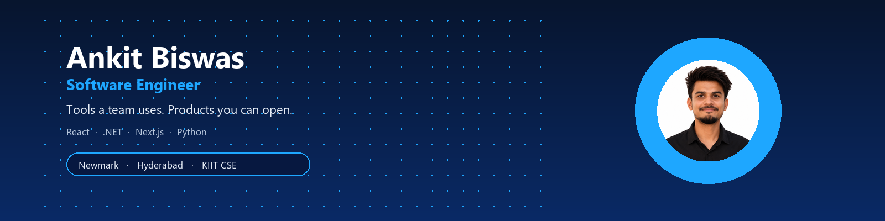
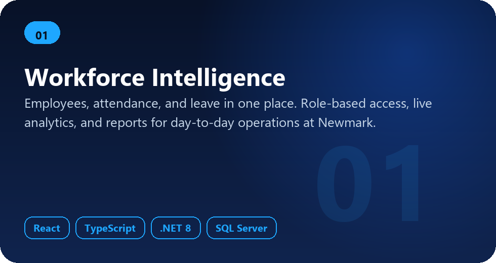
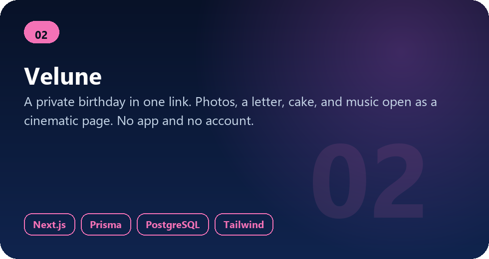
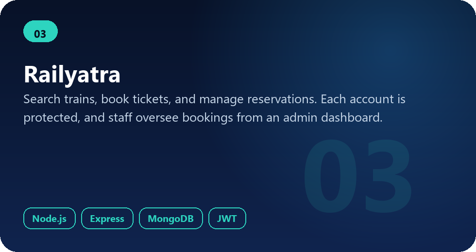
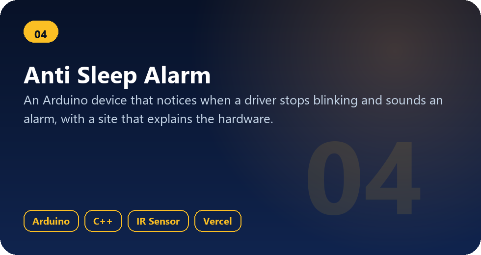
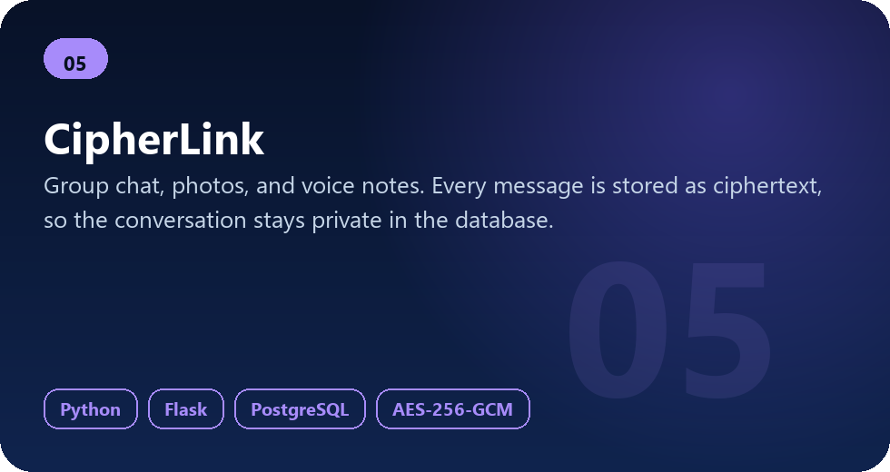
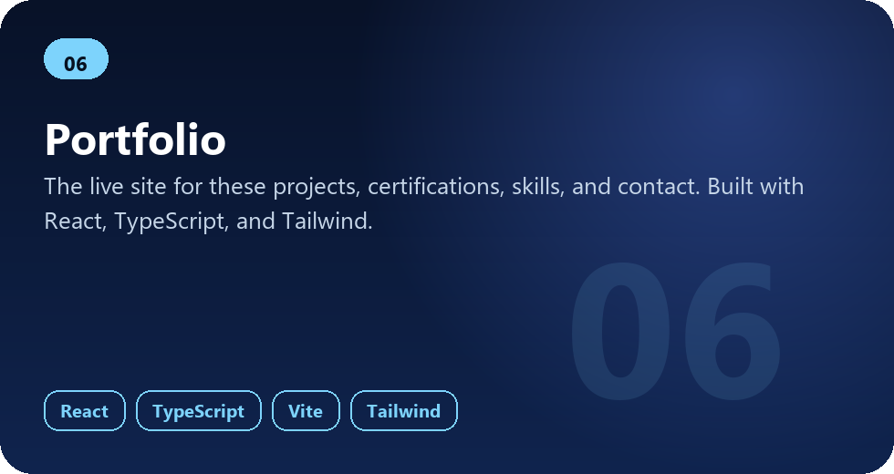

 

 

 

## About

<table>
<tr>
<td width="62%" valign="top">

Full-stack developer and **IT Associate Trainee at Newmark** in Hyderabad. I build production systems with **React**, **ASP.NET Core**, and **SQL Server**, and ship my own work in **Next.js** and **Python**.

That includes **Velune**, a private birthday opened from one link, **CipherLink**, a messenger that stores every chat as ciphertext, and an **Arduino alarm** that notices when a driver stops blinking.

I care about clean architecture, role-based security, and code a team can still change six months later.

</td>
<td width="38%" valign="top">

**Right now**

- Workforce tools at Newmark
- Encrypted messaging
- Next.js product work
- Azure DevOps delivery

**How I build**

- Layered APIs and real data models
- Auth and access designed in
- Performance checked on real workflows

</td>
</tr>
</table>

## Stack

**Frontend**

**Backend**

**Data & Cloud**

**Tools**

## Projects

Same lineup as the [live portfolio](https://ankit-portfolio-iota-one.vercel.app/).

  

[Live demo](https://niia-26-wfi.azurewebsites.net/) · [Source](https://github.com/Ankit2004-web/Workforce-Intelligence-Attendance-Management-System)

  

[Live demo](https://velune-iyco.onrender.com) · Private repository

  

[Live demo](https://railyatra-72z5.onrender.com) · [Source](https://github.com/Ankit2004-web/RailYatra)

  

[Live demo](https://anti-sleep-alarm-tawny.vercel.app/) · [Source](https://github.com/Ankit2004-web/anti-sleep-alarm)

  

[Source](https://github.com/Ankit2004-web/CipherLink)

  

[Live demo](https://ankit-portfolio-iota-one.vercel.app/) · [Source](https://github.com/Ankit2004-web/Ankit-portfolio)

## Certifications

 

 

 

 

<picture>
  <source media="(prefers-color-scheme: dark)" srcset="https://raw.githubusercontent.com/Ankit2004-web/Ankit2004-web/main/dist/github-contribution-grid-snake-dark.svg" />
  <source media="(prefers-color-scheme: light)" srcset="https://raw.githubusercontent.com/Ankit2004-web/Ankit2004-web/main/dist/github-contribution-grid-snake.svg" />
  
</picture>

 

## How I think about software

*Performance and security belong in the first design, not a later pass.*

Clear boundaries, predictable APIs, and data models that match the business. I ship in small steps and change the product from real use, not from guesses.

## Let's connect

 

Building software that is reliable, scalable, and meaningful.

